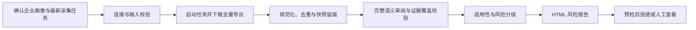

# 金融监管动态风险监测 Skill

面向企业的中国金融监管动态、监管通知与行政处罚数据分析工作流。它从已确认的最新采集任务中读取**全量**数据，将法规要求和执法信号与企业画像逐项匹配，生成带证据门槛的 HTML 风险报告，并可按已确认的渠道投递。

> 报告用于合规风险决策支持，不构成法律意见。仓库不包含 API Key、邮箱授权码、消息平台令牌或收件人信息。

## 能做什么

- 从当前确认的采集任务中启动、等待并导出完整数据；不以预览样本作为正式报告依据。
- 规范化来源字段、去重并建立完整证据索引，同时保留原始字段和来源快照。
- 根据企业的区域、牌照、产品服务、客户、渠道、数据处理、外包、反洗钱与治理等信息，判断法规或执法信号是否相关。
- 区分直接监管义务、执法关注信号、待核实事项和不适用事项，避免把处罚案例直接认定为企业违法。
- 对高优先级事项形成可执行的行动计划，明确动作、责任人、期限和交付物。
- 生成独立、邮件安全的 HTML 报告；可选择发送到固定消息平台用户/群组，或通过 SMTP 邮箱发送。

## 处理逻辑



关键控制点：

1. **当前批次隔离**：只分析客户本次确认的任务及其最新成功导出，避免混入历史结果。
2. **完整数据与可追溯性**：每份导出都记录任务身份、记录数、文件大小和快照哈希；每个有效发现都必须回溯到当前批次的证据。
3. **语义而非关键词判断**：审阅法规对象、地域、活动、义务、期限、例外、废止/修订和后果；关键词只用于定位，不决定风险。
4. **逐项适用性判断**：依次检查来源真实性、效力状态、地域、主体、业务活动、时间条件以及企业画像匹配。
5. **分级克制**：资料不完整、低置信度、草案、失效材料或间接执法信号不会被包装成高等级直接风险。
6. **投递前门槛**：报告与证据校验、目标地址、渠道认证和重复投递检查均通过后才允许发送。

## 两种企业画像模式

| 模式 | 适用情况 | 要求 |
| --- | --- | --- |
| `provided` | 正式企业风险分析 | 由客户提供并确认完整画像；缺失信息保持未知，不作补造。 |
| `synthetic_from_data` | 演示或流程验证 | 仅从本次数据主题生成演示画像；报告必须清晰标注为演示，且生成后仍需确认。 |

企业画像可包括企业类型、经营区域、许可活动、产品服务、客户类型、销售渠道、消费者保护、数据处理、技术外包、反洗钱、治理机制及合作方类型。

## 使用前准备

1. 在采集客户端的安全凭据位置配置 API Key；不要把密钥写入 JSON、命令行、报告或 Git。
2. 准备并确认企业画像、当前任务名称或任务 ID、每个任务的用途，以及投递渠道和固定目标。
3. 运行输入校验器。校验返回 `ready` 前，不启动任务、生成正式报告或发送内容。

```powershell
python scripts/validate_request.py --request request.json --stage collect
python scripts/validate_request.py --request request.json --stage publish --check-runtime
```

## 核心命令

构建当前批次的来源清单、规范化记录并建立证据索引：

```powershell
python scripts/build_run_manifest.py --metadata current-run-tasks.json --output collection-provenance.json
python scripts/normalize_records.py --input regulatory_notice:task-id=notice.json --output normalized-records.json
python scripts/build_evidence_index.py --input normalized-records.json --provenance collection-provenance.json --output evidence-index.json
python scripts/validate_review_coverage.py --index evidence-index.json --ledger semantic-review-ledger.json
```

验证分析并渲染 HTML：

```powershell
python scripts/validate_report.py --analysis analysis.json --result validation.json
python scripts/render_report.py --analysis analysis.json --output regulatory-risk-report.html
```

投递前先运行 `--dry-run` 与 `--preflight`。投递功能只会使用已经确认的目标与安全配置，详细要求见 [references/delivery-channels.md](references/delivery-channels.md)。

## 输出

正式可见交付物为：

- `regulatory-risk-report.html`：自包含、无 JavaScript、无远程字体或样式的风险报告。
- 如启用消息平台投递：管理层摘要和同一份 HTML 附件。
- 如启用邮件投递：同一份 HTML 作为正文和附件。

内部过程文件可包括标准化记录、证据索引、语义审阅台账、分析清单、报告指纹和投递回执；它们不应包含密钥。

## 安全与边界

- 只使用官方来源和完整正文支撑高优先级结论。
- 处罚记录用于识别执法重点和后果，不等于企业已经发生同类违规。
- 企业缺少控制证据时，只能表述为“缺少可验证证据”或“需要核验”，不能断言违法。
- 同一报告、企业画像、数据快照和目标组合会触发重复投递拦截，避免重复发送。
- 密钥、令牌、授权码和收件人配置只应保存在安全凭据或运行环境中，不应提交到仓库。

## 目录结构

```text
SKILL.md                         完整流程、门槛与命令说明
agents/openai.yaml               Skill 元数据
scripts/                         校验、规范化、证据索引、渲染和投递脚本
references/                      企业画像、适用性、风险标准、审阅和投递规范
assets/report-template.html      HTML 报告模板
```

## 自检

```powershell
python scripts/self_test.py
```

自检覆盖数据规范化、来源快照、语义审阅覆盖、风险门槛、HTML 渲染，以及消息和邮件通道的干运行/重复投递保护。

## 许可

当前项目未附带开源许可证。若计划公开分发或接受外部贡献，请先补充适用许可证。
